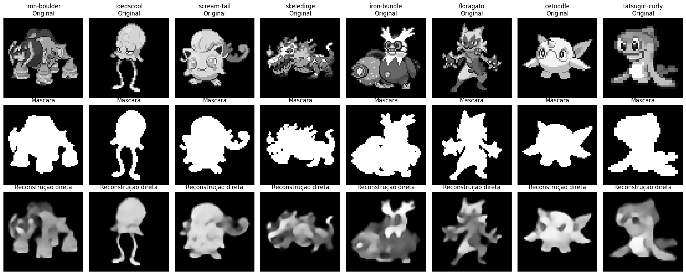
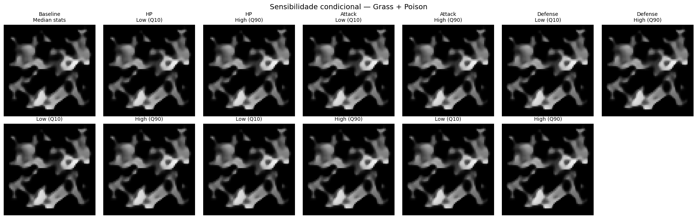

# Ultraball — ajuste do peso e warm-up da KL

Execução no Google Colab com CUDA, exportada em 17/11/2026. Registro de um experimento; não representa uma configuração comprovadamente superior à baseline.

| Configuração | Valor |
| --- | --- |
| Arquitetura | Ultraball espacial, 16 × 16 × 16 variáveis latentes |
| Beta final planejado | 2 |
| Warm-up linear | 80 épocas |
| Normalização da KL | KL bruta dividida por 32 |
| Reconstrução | L1 com máscara; peso do foreground 1 e do background 0,1 |
| Semente | 42 |
| Divisão dos dados | 905 treino, 60 validação, 60 teste |
| Limite de treinamento | 150 épocas |
| Encerramento observado | Early stopping na época 99 |
| Melhor checkpoint | Época 59, com beta 1,475 durante o warm-up |
| Seleção do checkpoint | Menor objetivo de validação com beta fixo em 2 |

## Resultados salvos

| Métrica | Valor |
| --- | ---: |
| Melhor objetivo de validação, beta fixo 2 | 184,2518 |
| Erro foreground no teste, soma média por imagem | 155,1196 |
| Erro background no teste, soma média por imagem | 21,4839 |
| KL normalizada no teste | 11,8215 |
| KL bruta no teste | 378,2878 |
| IoU por limiar de intensidade | 0,8316 |
| Dice por limiar de intensidade | 0,9051 |

Foreground e background acima são somas médias por imagem, não MAE por pixel. IoU e Dice são calculados limiarizando intensidades em 0,20; pixels escuros do Pokémon podem ser classificados como fundo. Essas métricas são de reconstrução e não comprovam qualidade das gerações inéditas.

## Inspeção visual e limites

As reconstruções preservam formas reconhecíveis, com borramento e perda de detalhes. A geração pelo prior mostrada apresenta estruturas fragmentadas; as mudanças de atributos produzem pequenas diferenças visuais nesse exemplo. Não é possível concluir melhora da geração.

A comparação direta com o checkpoint original não foi executada nesta sessão porque ele não estava disponível no Colab. Também não foram concluídas análises de diversidade e memorização. Uma única semente de treinamento não caracteriza a variabilidade do resultado.

O experimento muda simultaneamente o beta final e o warm-up em relação ao original (beta 1, warm-up 40). Para separar os efeitos, a próxima comparação proposta é beta 1 versus 2 mantendo warm-up 40, com os demais fatores iguais. O conjunto de teste já foi examinado nesta execução; não deve orientar a escolha de hiperparâmetros.

## Arquivos preservados

- `pokeBWTPST_ultraball.ipynb`: notebook executado, com parâmetros e saídas.
- `cvae_spatial_16x16x16_kl_beta2_warmup80_history.csv`: histórico completo das 99 épocas.
- `metricas_resumo.csv`: métricas consolidadas para consulta e comparação.
- `resumo.json`: configuração, métricas e hashes dos arquivos originais baixados.
- `figuras/`: curvas, reconstruções, geração pelo prior, KL por canal e diferenças entre atributos.

Os pesos `.pt` não estão neste registro do Git. Seu hash está no resumo; a cópia local foi mantida em `resultados/ajustado_beta2_warmup80/2026-11-17_colab`. Sem esse checkpoint, o notebook permite inspecionar os resultados salvos, mas gerar novas amostras do mesmo modelo exige obter os pesos ou treinar novamente.

